# 🚀 Awesome Container Orchestration

  

  
  
  
  
  
  

---

## 🌟 Top Container Orchestration Ecosystem

**Curated List of Production SaaS Platforms & Open-Source Cloud-Native Projects**  
*Focused on Cluster Management, Workload Scheduling, Serverless Containers & Declarative Deployment*  

**Last updated: October 2026**

This comprehensive guide tracks industry-grade **SaaS platforms**, **managed cloud Kubernetes offerings**, and battle-tested **open-source orchestrators**. Whether you are deploying high-throughput microservices, running multi-tenant enterprise clusters, orchestrating GPU-accelerated AI/ML models, or seeking ultra-lightweight setups for IoT/edge, this ecosystem map helps platform engineers and DevOps teams choose the right orchestration architecture.

---

## 📑 Table of Contents

- [📊 Sector Overview & Market Dynamics](#-sector-overview--market-dynamics)
- [☁️ SaaS & Hosted Platforms](#️-saas--hosted-platforms)
- [🔓 Open-Source GitHub Projects](#-open-source-github-projects)
  - [🏆 Core Container Orchestrators & Management](#-core-container-orchestrators--management)
  - [🛠️ Essential Orchestration & Cloud-Native Tooling](#️-essential-orchestration--cloud-native-tooling)
- [📈 Star History](#star-history)
- [💖 Support & Sponsorship](#-support--sponsorship)
- [🤝 How to Contribute](#-how-to-contribute)
- [⚖️ Disclaimer](#️-disclaimer)

---

## 📊 Sector Overview & Market Dynamics

The global container orchestration market is valued at approximately **$2.7 billion in 2026** (scaling from roughly $2.2B in 2024 and projected to surpass $8.5B+ by 2030 at a CAGR exceeding 25–31%). The sector is **moderately concentrated to oligopolistic** at the hyperscaler cloud infrastructure layer (dominated by Microsoft Azure, Amazon AWS, and Google Cloud, which collectively command over 65% of managed Kubernetes deployments), while remaining moderately fragmented and highly competitive in hybrid/multi-cloud management, on-premises distributions, and specialized edge platforms (e.g., Red Hat OpenShift, SUSE Rancher, and VMware Tanzu).

---

## ☁️ SaaS & Hosted Platforms

*Enterprise managed Kubernetes and serverless container platforms, sorted by parent company market valuation and scale (descending):*

| Product | Provider | Company Size (Valuation / Revenue) | Starting Pricing Tier | Free Tier / Trial Limit | Key Features |
| :--- | :--- | :--- | :--- | :--- | :--- |
| **[Azure Kubernetes Service (AKS)](https://azure.microsoft.com/en-us/products/kubernetes-service/)** | Microsoft | ~$3.1T+ Market Cap / ~$245B Rev | $0.00/hr (Free cluster management tier); pay only for worker VMs (starting ~$0.0104/hr for B-series) or optional Uptime SLA at $0.10/cluster/hr | Free cluster control plane forever (standard tier); $200 Azure credit for 30 days + 12 months popular free services for new accounts | Deep Microsoft Entra ID integration, Azure Monitor, GitHub Actions CI/CD, confidential computing nodes |
| **[Azure Container Apps](https://azure.microsoft.com/en-us/products/container-apps/)** | Microsoft | ~$3.1T+ Market Cap / ~$245B Rev | $0.000024/vCPU-s and $0.000003/GiB-s (Consumption plan active compute); $0.40 per 1M HTTP requests | 180,000 vCPU-seconds, 360,000 GiB-seconds, and 2,000,000 HTTP requests free every month (Consumption tier) | Serverless container platform built on Kubernetes, KEDA, Dapr, Envoy; scale-to-zero support |
| **[Google Kubernetes Engine (GKE)](https://cloud.google.com/kubernetes-engine)** | Google (Alphabet) | ~$2.2T+ Market Cap / ~$350B Rev | $0.10/cluster/hr (Standard cluster management fee, offset by $74.40 monthly credit) or Autopilot pod pricing ($0.0445/vCPU-hr + $0.0049/GiB-hr) | $74.40/month cluster management credit per billing account (covers 1 free zonal or Autopilot cluster forever); plus $300 credit 90-day trial | Fully managed Standard and Autopilot modes, automated upgrades, strong TPU/GPU AI workload support |
| **[Google Cloud Run](https://cloud.google.com/run)** | Google (Alphabet) | ~$2.2T+ Market Cap / ~$350B Rev | $0.000024/vCPU-s and $0.0000025/GiB-s (Tier 1 compute); $0.40 per 1M requests | 2,000,000 requests, 180,000 vCPU-seconds, 360,000 GiB-seconds, and 1 GiB egress free every month | Knative-based serverless container runtime, automatic scale-to-zero, fast cold starts, pay-per-use billing |
| **[Amazon EKS](https://aws.amazon.com/eks/)** | Amazon (AWS) | ~$2.0T+ Market Cap / ~$620B Rev | $0.10/cluster/hr ($73/month flat control plane fee); pay for EC2 worker nodes or Fargate compute | No perpetual free control plane; 12-month AWS Free Tier grants 750 hrs/mo of t2/t3.micro EC2 compute + 30-day Free Trial for EKS Anywhere | Managed node groups, Fargate integration, deep AWS IAM/VPC integration, EKS Anywhere for hybrid/on-prem |
| **[AWS Fargate](https://aws.amazon.com/fargate/)** | Amazon (AWS) | ~$2.0T+ Market Cap / ~$620B Rev | $0.04048/vCPU-hr and $0.004445/GB-hr (Linux x86 On-Demand, 1-min minimum); Fargate Spot from ~$0.0129/vCPU-hr | No perpetual free compute allowance (20 GB ephemeral storage included free per task); 12-month AWS Free Tier grants $100–$300 sign-up credits | Serverless compute engine for ECS and EKS; eliminates EC2 node management; task-level VM isolation |
| **[VMware Tanzu](https://www.vmware.com/products/app-platform/tanzu-kubernetes-grid)** | Broadcom | ~$850B+ Market Cap / ~$51B Rev | ~$350–$500/core/year (bundled under VMware Cloud Foundation (VCF) / vSphere Foundation; 16-core/CPU & 72-core order minimums) | 90-day evaluation proof-of-concept (PoC) free trial via Broadcom Support Portal | Enterprise Kubernetes runtime, tightly integrated with VMware vSphere, packaged governance and platform tooling |
| **[Red Hat OpenShift](https://www.redhat.com/en/technologies/cloud-computing/openshift)** | IBM / Red Hat | ~$215B+ Market Cap / ~$63B Rev | $0.171 per 4 vCPUs/hr (on-demand managed cloud, e.g., ROSA/ARO; ~$1,500/year per core-pair); self-managed from ~$1,000/core-pair/yr | 60-day self-managed evaluation trial (full enterprise features) or 30-day sandbox trial (Red Hat Developer Sandbox with 20 GB storage) | Enterprise Kubernetes with built-in CI/CD pipelines, full stack automated operations, multi-cloud and hybrid deployments |
| **[DigitalOcean Kubernetes](https://www.digitalocean.com/products/kubernetes)** | DigitalOcean | ~$4.5B+ Market Cap / ~$750M Rev | $0.00/month (Free standard control plane); worker nodes start at $12.00/month (Basic Droplet pool; optional HA control plane at $40/mo) | Free standard control plane forever; $200 platform credit valid for 60 days for new sign-ups | Free control plane, simplified cluster provisioning, integrated load balancers, cost-effective for growing teams |
| **[SUSE Rancher Prime](https://www.suse.com/products/rancher/)** | SUSE (EQT AB) | ~$800M+ Annual Rev / ~$2.7B Take-Private Valuation | ~$168/month (AWS Marketplace base starter tier for managed vCPUs) or ~$1,200/node/year enterprise subscription | 30-day commercial evaluation free trial (upstream Rancher OSS remains 100% free and open-source forever) | Centralized multi-cluster Kubernetes management across EKS, AKS, GKE, edge, and bare metal; unified RBAC and monitoring |

---

## 🔓 Open-Source GitHub Projects

*Open-source container orchestrators, engines, distributions, and management platforms, sorted strictly in descending order by GitHub Stars:*

### 🏆 Core Container Orchestrators & Management

1. **[Kubernetes](https://github.com/kubernetes/kubernetes)**   
   **Production-Grade Container Scheduling and Management** (Apache-2.0)  
   The undisputed global standard for container orchestration—powering over 82% of container users in production. Scales effortlessly up to 5,000 nodes and 150,000 pods per cluster. Provides automated rollout/rollback, horizontal pod autoscaling (HPA), built-in DNS service discovery, self-healing, storage orchestration, and an expansive CNCF ecosystem.

2. **[Docker Engine & Swarm (Moby)](https://github.com/moby/moby)**   
   **The Open Framework for Container Systems & Built-in Docker Swarm Mode** (Apache-2.0)  
   The core engine behind Docker containers containing Docker Swarm. Swarm mode turns a group of Docker hosts into a single virtual host with declarative service definitions, overlay networking, secret management, and built-in ingress routing without extra infrastructure overhead.

3. **[Portainer](https://github.com/portainer/portainer)**   
   **Universal Container Management Web Interface** (zlib License)  
   A powerful visual management UI for Docker, Docker Swarm, and Kubernetes. Eliminates the complexity of YAML and CLI commands, enabling teams to deploy apps, manage volumes/networks, monitor container health, and enforce RBAC through an intuitive browser dashboard.

4. **[Docker Compose](https://github.com/docker/compose)**   
   **Multi-Container Orchestration for Local Development & CI** (Apache-2.0)  
   The developer standard for defining and running multi-container Docker applications. Define entire microservice application topologies in a declarative `compose.yaml` file with service dependencies, volumes, networks, environment files, and profiles.

5. **[k3s](https://github.com/k3s-io/k3s)**   
   **Lightweight, CNCF-Certified Kubernetes Distribution** (Apache-2.0)  
   Packaged as a single <70 MB binary that installs in under 30 seconds. Strips out legacy, alpha, and in-tree cloud providers, replacing etcd with sqlite3 (or external DBs) while bundling Traefik, CoreDNS, Flannel, and local-path storage. Ideal for edge computing, IoT, ARM devices, and dev environments.

6. **[SUSE Rancher](https://github.com/rancher/rancher)**   
   **Multi-Cluster Kubernetes Management Platform** (Apache-2.0)  
   A complete enterprise container management stack providing unified governance, centralized RBAC, monitoring, logging, and GitOps continuous delivery across any certified Kubernetes distribution (EKS, AKS, GKE, RKE2, k3s, or bare metal).

7. **[HashiCorp Nomad](https://github.com/hashicorp/nomad)**   
   **Simple, Flexible, and High-Throughput Workload Orchestrator** (BUSL 1.1)  
   A single-binary orchestrator capable of scheduling Docker containers, non-containerized legacy binaries, Java applications, and VMs across bare-metal and cloud environments. Offers native multi-region federation and seamless integration with HashiCorp Consul and Vault.

8. **[MicroK8s](https://github.com/canonical/microk8s)**   
   **Zero-Ops, Pure Kubernetes for Workstations and Appliances** (Apache-2.0)  
   Canonical's lightweight Kubernetes distribution featuring single-command addon toggling (`microk8s enable ingress dns gpu storage`). Includes automatic security updates, high availability via Dqlite clustering, and seamless GPU passthrough for machine learning workloads.

9. **[k3d](https://github.com/k3d-io/k3d)**   
   **Fast, Containerized Multi-Node k3s Kubernetes Clusters** (MIT)  
   A lightweight utility to run multi-node k3s clusters inside Docker containers. Spins up full, ephemeral Kubernetes clusters in seconds for local development, rapid integration tests, and CI/CD pipelines.

10. **[k0s](https://github.com/k0sproject/k0s)**   
    **Zero-Friction, Single-Binary Kubernetes Distribution** (Apache-2.0)  
    A standalone, all-in-one Kubernetes binary without host OS dependencies. Features isolated control plane architecture, flexible storage backends, built-in network security, and minimal maintenance overhead for cloud, bare-metal, and edge deployments.

11. **[Karmada](https://github.com/karmada-io/karmada)**   
    **Open, Multi-Cloud, Multi-Cluster Kubernetes Orchestration** (Apache-2.0)  
    A CNCF incubating project enabling turnkey multi-cloud and hybrid-cloud management. Provides cross-cluster workload propagation, failover, multi-cluster service discovery, and unified API endpoints with 100% native Kubernetes API compatibility.

12. **[Open Cluster Management (OCM)](https://github.com/open-cluster-management-io/ocm)**   
    **Modular Multi-Cluster Kubernetes Fleet Architecture** (Apache-2.0)  
    A CNCF sandbox project focused on scalable cluster lifecycle management, policy-driven security governance, and multi-cluster placement algorithms for enterprise hybrid cloud fleets.

---

### 🛠️ Essential Orchestration & Cloud-Native Tooling

*Crucial companion tools for package management, GitOps synchronization, cluster monitoring, and automated workload delivery (sorted by Stars):*

1. **[K9s](https://github.com/derailed/k9s)**   
   **Terminal-Based UI for Kubernetes Clusters** (Apache-2.0)  
   Provides a blazing-fast curses-based terminal dashboard to observe, inspect, port-forward, and manage Kubernetes resources with intuitive vim-style keyboard navigation.

2. **[Minikube](https://github.com/kubernetes/minikube)**   
   **Local Kubernetes Engine for Learning & Testing** (Apache-2.0)  
   The official Kubernetes SIG tool for quickly spinning up a local single-node or multi-node cluster supporting multiple virtualization drivers (Docker, Podman, Hyper-V, KVM).

3. **[Helm](https://github.com/helm/helm)**   
   **The Kubernetes Package Manager** (Apache-2.0)  
   The standard package manager for defining, versioning, sharing, and deploying complex cloud-native applications across Kubernetes clusters via Helm Charts.

4. **[OpenFaaS](https://github.com/openfaas/faas)**   
   **Serverless Functions & Microservices on Kubernetes** (MIT)  
   Makes it effortless to deploy event-driven functions and microservice containers to Kubernetes with automated scaling, built-in Prometheus metrics, and native CLI tooling.

5. **[Watchtower](https://github.com/containrrr/watchtower)**   
   **Automated Container Base Image Updates** (Apache-2.0)  
   Monitors running Docker containers and seamlessly restarts them whenever upstream image registries push an updated image tag.

6. **[Argo CD](https://github.com/argoproj/argo-cd)**   
   **Declarative GitOps Continuous Delivery for Kubernetes** (Apache-2.0)  
   Automates application state reconciliation directly from Git repositories, ensuring live cluster state matches committed declarative manifests.

7. **[Kubespray](https://github.com/kubernetes-sigs/kubespray)**   
   **Ansible-Powered Production Kubernetes Deployer** (Apache-2.0)  
   The gold standard for automated bare-metal, OpenStack, and on-premises production Kubernetes cluster provisioning and lifecycle operations.

8. **[Flux CD](https://github.com/fluxcd/flux2)**   
   **Open & Extensible Continuous Delivery Engine for Kubernetes** (Apache-2.0)  
   A CNCF graduated GitOps toolkit that automates cluster configuration synchronization with Git repositories and OCI image registries.

9. **[Knative Serving](https://github.com/knative/serving)**   
   **Serverless Workload Management & Autoscaling for Kubernetes** (Apache-2.0)  
   The foundation behind Google Cloud Run, offering scale-to-zero, request-driven autoscaling, and zero-downtime routing snapshots.

10. **[Volcano](https://github.com/volcano-sh/volcano)**   
    **High-Performance Batch Computing System for Kubernetes** (Apache-2.0)  
    A CNCF batch scheduling engine tailored for AI/ML training, big data analytics (Spark, Flink, PyTorch, TensorFlow), and HPC workloads.

---

## 📈 Star History

---

## 💖 Support & Sponsorship

Thank you for visiting and supporting **Awesome Container Orchestration**! 🌟

Maintaining this curated ecosystem guide takes ongoing research, real-time pricing verification, and open-source tracking. If you find this resource valuable for your platform architecture, infrastructure decisions, or engineering workflow:

- ⭐ **Star this repository** to help others discover it!
- 🍴 **Fork and contribute** your favorite orchestrators and battle-tested tools.
- 📢 **Share with your team** and fellow DevOps / cloud-native engineers.
- ☕ **Buy me a coffee & support future maintenance**:  
  👉 **[Sponsor on GitHub Sponsors](https://github.com/sponsors/ishandutta2007)**

Your support makes a huge difference in keeping this repository fresh, accurate, and comprehensive!

---

## 🤝 How to Contribute

1. 🍴 **Fork the repository** on GitHub.
2. 📝 **Add or update entries** in `README.md` following the tabular or bulleted format.
3. 🔍 Ensure all links point to official websites/repositories and descriptions remain factual and objective.
4. 🚀 **Submit a Pull Request** with a concise description of your changes.

---

## ⚖️ Disclaimer

- This is an independent **community-curated collection** intended for educational, architectural, and informational purposes. Mention of specific vendors or projects does not constitute formal endorsement.
- Production container environments must adhere to security hardening, robust identity management (RBAC), TLS encryption, network isolation, and organizational compliance policies.
- Pricing metrics, limits, and cloud provider tiers are tracked accurately as of October 2026; always consult official vendor documentation for live regional billing rates and enterprise agreements.

---

  <b>Built with ❤️ for platform engineers, SREs, and cloud-native architects worldwide.</b> 
  <i>Let's make Container Orchestration more open, automated, and scalable.</i>

# Awesome-Container-Orchestration

